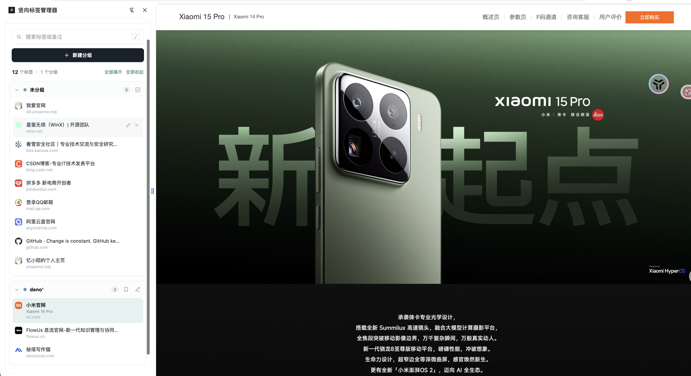

# 竖向标签管理器

一个使用 Chrome Side Panel 的 Manifest V3 工作区扩展，包含竖向标签管理、AI 网页翻译和一线技术支持工单跟进。工单数据默认保存在浏览器本地。

## 解决的痛点

当同时打开很多相似网页时，只看网页标题很难快速分辨它对应哪个用户、项目或需求，往往还要依赖 UUID、网址或浏览记录定位。这个工具允许直接给标签添加备注，并把备注显示在标签主标题位置，让人一眼看出“这是哪个用户、处理什么需求”；同时保留原始网页标题、Chrome 分组和标签顺序，方便继续管理和查找。

## 效果预览

展开列表：

未分组标签多选建组：

分组展开状态同步：

## 安装

1. 打开 Chrome 的 `chrome://extensions`。
2. 开启右上角的「开发者模式」。
3. 点击「加载已解压的扩展程序」，选择这个文件夹。
4. 点击工具栏里的扩展图标，打开 Side Panel。

首次使用翻译功能时，在侧边栏顶部切换到「翻译设置」，填写 API 地址、模型 ID 和 API Key。设置页已集成在侧边栏工作区中，无需打开额外标签页。扩展支持 OpenAI 兼容的 Chat Completions 接口，也可以使用 OpenAI、DeepSeek、通义千问或 Ollama 等预设。

## 使用

- 点击标签标题切换到对应页面。
- 点击铅笔图标添加或编辑备注，按回车或点击「保存」。
- 添加备注后，备注会显示为标签主标题，原始标签标题会显示在下面的小字中。
- 「新建分组」会把当前标签加入一个新的 Chrome 原生标签组。
- 分组标题右侧的铅笔可以重命名分组；分组内容会随 Chrome 标签组同步更新。
- 分组标题右侧的书签按钮可以手动把当前分组保存到 Chrome「书签栏」下的新文件夹；不会自动同步，也不会修改已有书签。
- 工具保持展开显示。需要缩窄或放宽时，直接拖动 Chrome 侧边栏与网页之间的分隔线即可调整宽度；这个宽度由 Chrome 管理，扩展不会自动覆盖它。
- 分组箭头与 Chrome 标签栏里的原生分组折叠状态同步；在任一处展开或收起，另一处都会更新。
- 分组顺序和标签顺序按浏览器当前标签栏排列；在浏览器中拖动标签或分组后，侧边栏会同步更新。
- 在「未分组」标题右侧点击多选按钮，可以选择多个标签并一次性新建 Chrome 标签组。
- 搜索会同时匹配标题、网址和备注。

### AI 网页翻译

- **整页翻译**：点击侧边栏顶部的翻译按钮、浏览器工具栏弹窗中的「翻译当前网页」，或在网页右键菜单中选择「翻译当前网页」。英文段落会以双语对照形式显示，滚动页面和动态加载的内容也会继续处理。
- **网页悬浮控制条**：开启整页翻译后，网页右上角会显示翻译状态悬浮条，可直接关闭翻译或打开翻译设置。
- **划词翻译**：选中网页文字后点击文字旁边的「译」按钮即可显示翻译气泡；也可以右键选中文字，选择「翻译选中文本」。
- **工具栏弹窗**：点击扩展工具栏图标，可以查看当前页面的翻译状态、开启或关闭整页翻译，以及打开翻译设置。
- **自定义模型**：设置页支持任何 OpenAI 兼容的 Chat Completions 接口，可填写 API 地址、模型 ID 和 API Key，并提供 OpenAI、DeepSeek、通义千问、Ollama 预设。
- **译文配色**：支持所有网站默认译文颜色、按域名单独设置颜色，以及根据页面背景自动调整颜色。
- **iframe 和动态内容**：支持页面内 iframe 内容；网页新增内容会自动扫描并翻译。
- **关闭翻译**：可以通过网页右上角悬浮条、工具栏弹窗、侧边栏翻译按钮或右键菜单再次切换关闭。

翻译功能需要配置可用的 API Key。API Key 仅保存在浏览器本地，并发送到你设置的兼容接口地址。Chrome 内置页面（如 `chrome://`）和 Chrome 网上应用店页面不允许注入翻译脚本。

### 工单跟进（本地 MVP）

- 在顶部切换到「工单跟进」，点击「新建工单」会在看板直接生成可编辑卡片；标题、客户/项目和状态都可在卡片内修改，不跳转到其他页面。支持按工单、客户和进展内容检索。
- 添加进展时直接在卡片底部输入并点击「添加进展」，无需弹出对话框或离开当前看板。
- 每张工单可单独展开/收起，状态会保存在本地；顶部支持全部展开/全部收起。收起时仍显示客户、状态、超时和最近更新摘要。
- 支持按状态筛选、按最近更新/最久未更新/超时优先排序；可用圆点单选设置优先级，并选择渠道、填写客户与工单/备注。
- 工单状态包括待响应、处理中、等待客户、已解决和已关闭；卡片用字母徽标和紧凑菜单选择状态。状态变更及进展记录都会追加到时间线，并更新时间戳。
- 看板显示总时长、当前状态时长、距上次更新时长。超时判定依据“距上次更新”，更新包括状态变更和进展记录。
- 首次响应和后续跟进阈值独立：当前默认分别为 60 分钟、24 小时；可在 `chrome.storage.local` 的 `ticketSettings` 中调整。每 5 分钟检查，并通过浏览器通知提示超时工单。
- 支持 JSON 导入/导出及每日汇总（新增数、有进展数、当前超时数）。
- 当前为单浏览器本地模式，尚不支持团队协作或从聊天渠道自动获取消息；工单需手动录入。请定期导出备份数据。

## 工单功能范围与验收

本期包含：渠道选择、状态管理、进展时间线、三类计时、首次/后续超时判断、看板检索、页面内超时标识、浏览器通知、JSON 导入导出和每日汇总。

本期不包含：团队账号/云端同步、消息自动获取、复杂 SLA 日历（节假日/工作时段）、权限审批和服务端审计。

可直接测试的验收标准：
1. 新建工单后刷新侧边栏，工单仍存在；
2. 可切换工单状态，时间线记录状态变更；
3. 添加进展后，记录显示时间并刷新“距上次更新”；
4. 看板显示总时长、当前状态时长及距上次更新时长；
5. 超过配置阈值后，看板标出超时并触发浏览器通知，首次响应和后续跟进使用各自阈值；
6. 搜索可命中标题、客户、渠道和进展文本；
7. 导出 JSON 后重新导入，工单及时间线可恢复。

待确认事项：首次响应与后续跟进的正式 SLA；各渠道定义；优先级与标签；解决/关闭后是否可编辑；每日汇总时区和时间；通知频率和静默策略；数据保留期限；导入重复工单处理；是否需要自动获取消息；未来团队共享和权限模型。
