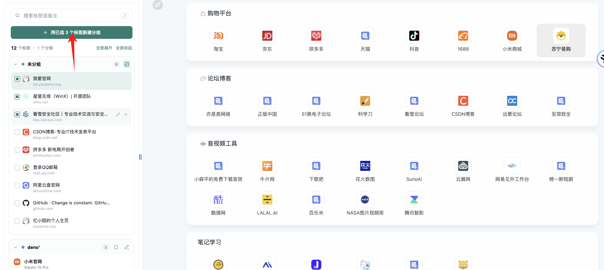
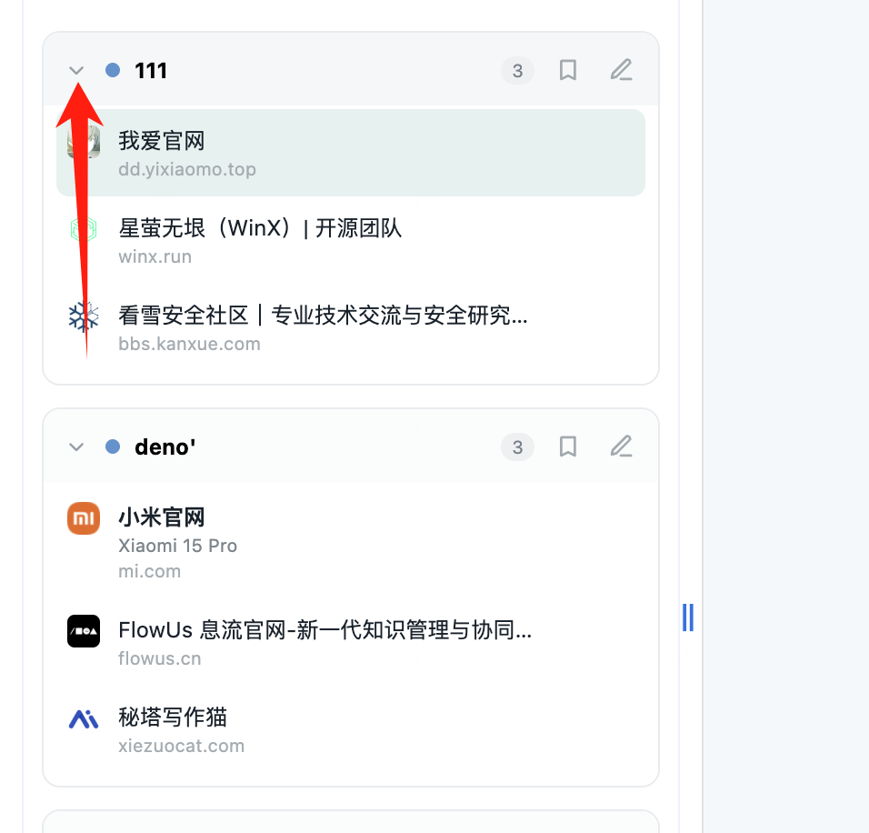

# 竖向标签管理器

一个使用 Chrome Side Panel 的 Manifest V3 标签管理扩展。它会读取当前窗口的标签和原生标签组，在左侧竖向列表中展示；每个标签都可以保存备注，备注保存在浏览器本地。

## 解决的痛点

当同时打开很多相似网页时，只看网页标题很难快速分辨它对应哪个用户、项目或需求，往往还要依赖 UUID、网址或浏览记录定位。这个工具允许直接给标签添加备注，并把备注显示在标签主标题位置，让人一眼看出“这是哪个用户、处理什么需求”；同时保留原始网页标题、Chrome 分组和标签顺序，方便继续管理和查找。

## 效果预览

展开列表：

未分组标签多选建组：

分组展开状态同步：

## 安装

1. 打开 Chrome 的 `chrome://extensions`。
2. 开启右上角的「开发者模式」。
3. 点击「加载已解压的扩展程序」，选择这个文件夹。
4. 点击工具栏里的扩展图标，打开 Side Panel。

## 使用

- 点击标签标题切换到对应页面。
- 点击铅笔图标添加或编辑备注，按回车或点击「保存」。
- 添加备注后，备注会显示为标签主标题，原始标签标题会显示在下面的小字中。
- 「新建分组」会把当前标签加入一个新的 Chrome 原生标签组。
- 分组标题右侧的铅笔可以重命名分组；分组内容会随 Chrome 标签组同步更新。
- 分组标题右侧的书签按钮可以手动把当前分组保存到 Chrome「书签栏」下的新文件夹；不会自动同步，也不会修改已有书签。
- 工具保持展开显示。需要缩窄或放宽时，直接拖动 Chrome 侧边栏与网页之间的分隔线即可调整宽度；这个宽度由 Chrome 管理，扩展不会自动覆盖它。
- 分组箭头与 Chrome 标签栏里的原生分组折叠状态同步；在任一处展开或收起，另一处都会更新。
- 分组顺序和标签顺序按浏览器当前标签栏排列；在浏览器中拖动标签或分组后，侧边栏会同步更新。
- 在「未分组」标题右侧点击多选按钮，可以选择多个标签并一次性新建 Chrome 标签组。
- 搜索会同时匹配标题、网址和备注。
